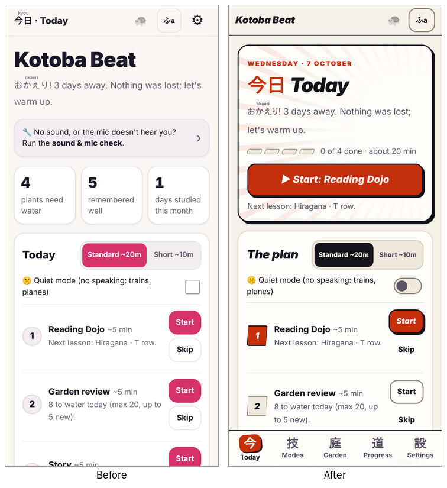
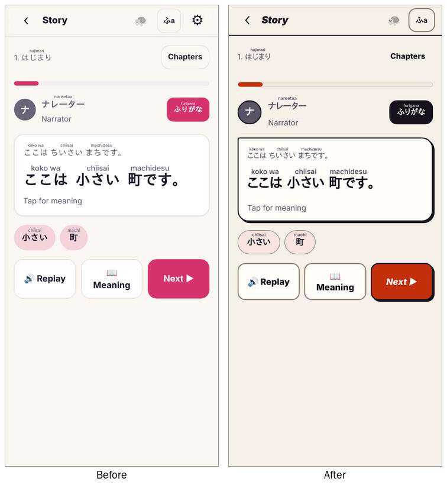
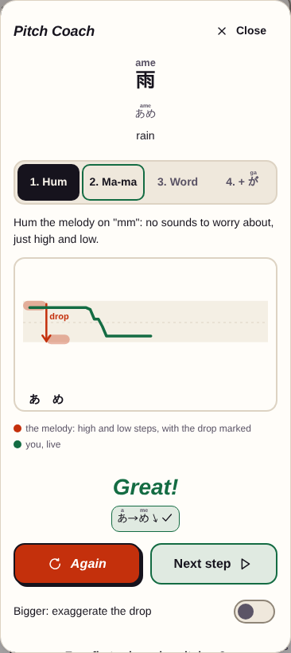

# Kotoba Beat (web)

A Japanese study game for PC and phone that I built for my own learning. It turns the research on how people learn languages fast (recall practice, spaced review, lots of listening and speaking) into short game modes, with an original shōnen-style story to read along the way.

**Live site:** https://rykoha.github.io/kotoba-web/

  
  
  

## What's in it

- **Today:** a guided daily session of review, story input, speaking and a skill that rotates by weekday, with a 10-minute short day and a quiet mode.
- **Reading Dojo:** hiragana, katakana and starter kanji.
- **Nineteen game modes:** Kana Brush, Rival Battle, Encounters, Garden (spaced review of voiced JLPT N5 to N3 decks), Type It, Story, Library, Particle Train, Kanji Forge, Conjugation Dojo, Sentence Builder, Katakana Rush, Rhythm, Pitch Duel, Speak Slice, Shopkeeper, Listening Lab, Numbers & Time and Walk Mode.
- **Road to the JLPT:** content tagged N5, N4 and N3, a readiness meter and original mock tests scored like the real one.
- **Speaking feedback on the device:** a pronunciation check for sounds, pitch accent and rhythm, and a Pitch Coach that draws your pitch live.
- **Gentle by design:** generous scoring, the answer shown on a miss instead of a lost life, and no streaks.

## How it's built

- Plain HTML, CSS and JavaScript with no build step and no framework. It works offline as an installable web app (service worker). There are no accounts and no server of its own; the only network use is opt-in (sync and the AI chat partner, below).
- Spaced review uses a small implementation of the FSRS algorithm (`js/srs.js`).
- Pitch tracking, speech recognition and the mora-by-mora scoring all run in the browser (Web Audio and the Web Speech API).
- Voice clips are generated ahead of time with VOICEVOX and shipped as small MP3s, so audio works on every device.
- Optional sync across devices through one private GitHub gist, using a token that stays on the device.
- Playwright tests at phone and desktop size run on every pull request.

## Credits

- **Voices:** VOICEVOX:四国めたん, VOICEVOX:白上虎太郎, VOICEVOX:青山龍星, VOICEVOX:玄野武宏, VOICEVOX:東北イタコ, VOICEVOX:ずんだもん, VOICEVOX:春日部つむぎ, VOICEVOX:東北ずん子, VOICEVOX:剣崎雌雄. Generated with [VOICEVOX](https://voicevox.hiroshiba.jp/) and used under each character's terms. The credits are also shown in the app's Settings.
- **Readings and lookup:** deck readings were checked against, and tap-to-look-up meanings beyond the decks come from, [JMdict](https://www.edrdg.org/wiki/index.php/JMdict-EDICT_Dictionary_Project), © the [Electronic Dictionary Research and Development Group](https://www.edrdg.org/), used under the [Creative Commons Attribution-ShareAlike 4.0 licence](https://www.edrdg.org/edrdg/licence.html).
- **Kana strokes:** Kana Brush strokes from [KanjiVG](https://kanjivg.tagaini.net/), © Ulrich Apel and contributors, CC BY-SA 3.0.
- **Furigana and romaji:** generated at build time with [Open JTalk](https://open-jtalk.sourceforge.net/) (Modified BSD licence) through [pyopenjtalk-plus](https://github.com/tsukumijima/pyopenjtalk-plus).
- **Spaced review:** the FSRS v4 algorithm and default weights from the [open-spaced-repetition](https://github.com/open-spaced-repetition) project.
- Story, example sentences, mnemonics and icons are original to this project.

## Working on it

- Progress is saved in the browser on each device. To keep devices in step, turn on Settings > Sync across devices (optional, below). Export / Import still works as a manual backup.
- When you change any file, bump `CACHE_VERSION` in `sw.js` so installed copies update.

## Garden review cards

The Garden's daily watering (`store.dailyGardenQueue`) mixes several kinds of card, each with its own FSRS schedule:

| Card | What you do | Comes in |
|---|---|---|
| 👁 Meaning | See the Japanese, recall the meaning. | Every word. The plant's growth stage follows this card only. |
| 🎧 Listen | Hear the word's clip with no text, recall the meaning. | Once a word's Meaning card reaches stage 3. |
| 🗣 Say it | See the English (the example's English as an optional hint) and say the Japanese. Graded by speech recognition when it's there; otherwise, or in Quiet mode, you grade yourself after the reveal. | After the word's Listen card. |
| 📐 Grammar | Fill the blank in one of a course grammar point's example sentences. The examples rotate. | When the lesson is read or the unit is done. |
| 🔁 Conjugation | Pick a conjugated form, for example the て-form of 食べる. | When the form is practised in Conjugation Dojo. |

The daily review cap covers every card. New cards each day:
- up to 5 words
- up to 2 grammar cards
- up to 3 Listen / Say it cards

Fewer come in while recent accuracy is under ~80%, and none under ~70% (`tuning.js`).

Other modes can read the due grammar cards with `store.dueGrammar()` and record results with `store.reviewGrammar(key, ok)`. The cards and their fill-in blanks live in `js/grammar-cards.js`.

**Stuck words.** A card missed 4 times is marked as needing help. Its plant shows a 🩹; plants never wilt or die. The next time the card comes up, a help panel shows first:
- the word slowed down
- an example sentence
- a picture mnemonic (`js/mnemonics.js`, English only, so no new clips)
- any look-alike or sound-alike word side by side (`js/word-help.js`, drawn from the app's own words, so each one can be played)

Two right answers in a row clear the mark. The Garden screen's "Needs help" button practises these cards on purpose.

**Saved progress.** These cards are saved progress v6:
- `items[id].dirs` holds the Listen and Say it cards.
- `grammar` holds the grammar cards.
- `lapses`, `help` and `ok2` track the needs-help mark.
- `newd` and `newg` count each day's new directions and grammar cards.

The migration plants grammar cards for lessons already read and conjugation forms already practised. The sync merge keeps each card's own most recent review.

## Ren's Messages

Phone-style chats with the story cast: Ren, then Kaito (after story chapter 2), the Master (after chapter 4), and Sora and Granny Kiku (after chapter 6). Engine in `js/messages.js`, messages in `js/messages-data.js` and `js/messages-cast.js`, inbox at `#/messages`, card on Today.

- **Switching who you message.** A row of contacts at the top of the inbox; people not met yet show a lock and the chapter where you meet them. Each chat is its own thread (a message's sender is in its data, so saved progress didn't change).
- **Speech levels.** Each person keeps their own way of talking: Sora (a kid) and Kaito text casually, Granny Kiku politely, the Master in a teacher's short plain style, and Ren politely at tier 1, then casually. The chat header says how they talk and which level fits when you write back.
- **Messaging someone first.** When a person has nothing waiting and hasn't written today, you start the chat by picking an opener: one polite, one casual. The fitting one is marked right; a miss names the level that fits, and they still write back (graded as `grammar`, `reg:<person>`). The first time, they say hello first (messages marked `intro`). There's no daily limit: a reply that carries the conversation on is answered right away, and when a conversation ends a new one can start, as long as that person has messages at the learner's level left.

- **Arriving.** Opening the app (Today) can bring one new message a day; chatting in the inbox has no limit. Nothing expires: unanswered messages stay, and skipped days lose nothing.
- **Welcome back.** After 4 or more days away the next message is a warm 久しぶり！ note, never a guilt trip.
- **Levels** (`learnerTier`; tiers 4 and 5 are N4 and N3 chat):
  - Tier 1: kana-only polite messages.
  - Tier 2: casual speech, once hiragana is done and 4 course units (or 60 Garden words) are.
  - Tier 3: N4 grammar (～たら, ～てしまう, ～なければならない, ～そうだ, ～かもしれない, ～ようと思う), once unit p1-10 is done (or 200 words).
  - Kanji show only when every kanji in the message is known (Dojo or Kanji Forge). Otherwise the kana version shows.
- **Words.** Each message lists its Garden words. It can arrive only when at most one of them is new, and that word has a "＋ New word" chip that plants it.
- **Reading it.** Each message is voiced in its sender's VOICEVOX voice, with the usual reading help. A "what did they mean?" tap checks comprehension lightly: a miss shows the answer, nothing else. The tap is graded as `vocab` (`msg:<id>`).
- **Replies.** 2-3 Japanese replies with English under each. The reply picks the next message (short conversations over days). Otherwise the next one is a fresh conversation: story moments first (the latest chapter reached), then the learner's tier.
- **Pool.** Original writing at every tier for every person, plus welcome-back notes from Ren.
- **Saved progress v11** adds `messages.thread` (`{ id, day, at, reply, ok }`, oldest first). The sync merge keeps every message from both devices once, and a copy with a reply or answer wins.
## Library and tap to look up

**Library** (`#/play/library`, `js/modes/library.js`): short graded readers for reading a lot of easy Japanese. They're
original side stories of the story cast and everyday pieces (a diary, a letter, a notice, a menu), 12-18 lines each, in
`js/library-n5.js`, `js/library-n4.js` and `js/library-n3.js` (assembled in `js/library-data.js`).
- Written almost entirely in the words the decks up to their level teach. `python3 tools/build_lookup.py --check N4`
  lists, per reader, the words beyond the decks (for writing new readers).
- A shelf per level (locked levels show their lock line). Each reader shows how many of its words are already in the
  Garden ("% met"); the suggested next read is the unread one with the most words met. Around 90% or more reads smoothly.
- Reading: the whole text on one page, every line voiced in its speaker's voice (or "Play all"), English hidden per line
  until asked for, then 2-3 light questions (a miss just shows the answer). The end screen offers the story's Garden
  words not planted yet; nothing is planted for you.
- **Words read** (each finished reader's words, times read) shows on the shelf, on Today's Library card and on Progress.
- Saved progress v13 adds `library.read` (`id -> { n, at, q, qt }`). The sync merge keeps each reader's larger count,
  latest time and best score.

**Tap to look up** (`js/lookup.js`): every word in a Story line, one of Ren's Messages or a Library reader can be tapped.
A card at the bottom shows the word, its reading and romaji, its meaning, a Hear button, and "Plant in Garden" when it's
a Garden card not planted yet. Particles and endings get a short note; numbers name their counter. Words are worked out
ahead of time: `tools/build_lookup.py` (run by `tools/build_assets.py`) splits each line with Open JTalk, joins
conjugation endings to their verb (たべました is たべる), and matches the dictionary form to the line's tagged words,
then the Garden cards, then JMdict (EDRDG, CC BY-SA 4.0) for anything else. It writes `js/lookup-data.js`; the JMdict
meanings it used are kept in `tools/jmdict-glosses.tsv`, so a rebuild without the dictionary keeps them. To refresh
them, set `JMDICT_DB` to a jamdict SQLite file (the `jamdict-data` package ships one). Looked-up words without a Garden
card get their own clip.

## Walk Mode and Type It

**Walk Mode** (`#/play/walk`, `js/modes/walk.js`): eyes-free review for walks and commutes. It says the English (the
device's English voice; without one it shows on screen), pauses for you to say the Japanese out loud, then plays the
answer twice; every third word its example sentence gets the same treatment. Words come from the Garden, due and shaky
ones first; with fewer than 8 planted, the first deck words come in as listen-and-repeat. 5, 10 or 15 minutes, pause,
skip, a "more time" option, and the words on screen or not. Nothing is graded, so reviews are never changed. The screen
stays awake while it plays (Wake Lock) and lock-screen media keys can pause it. Today links to it on Short days. Its
choices are kept on the device (`kotobaBeat.walk`), not in progress.

**Type It** (`#/play/type`, `js/modes/type.js`, checks in `js/kana-input.js`): type the answer from memory, three ways
round: see the word and type its English **meaning**, see it and type its **reading** in romaji (or kana), or see the
English and type the **Japanese** (Japanese keyboard, or romaji that turns into kana as you type). Words written in
hiragana, katakana, kanji or all. Garden words first (due ones first), topped up with the decks' first words and
Katakana Rush words. Scoring is generous: any listed meaning, typos, plurals, a long vowel or small っ left out counts
("close enough"), and "I was right" counts a miss that was fine. A miss shows the answer, brings the word back three
words later and makes a Garden word due by tomorrow. Graded as vocab (reading: kana or kanji). Its choices stay on the
device (`kotobaBeat.type`).

## Rival Battle

A monster-battle-style fight built entirely from review (`js/modes/rival.js`, attacks in `js/rival-items.js`, lines and fighters in `js/rival-data.js`, drawings in `js/rival-art.js`).

- **The arena.** The rival's name card and stamina bar sit top left with the rival drawn top right; your fighter is drawn from behind bottom left with their card, stamina bar and numbers bottom right. Stamina bars run green, yellow under half, red under a fifth, and drain visibly; a knocked-out character sinks away before the end screen.
- **Rivals.** Kaito challenges you from the start. Master joins after story chapter 4, Sora after chapter 6 and Granny Kiku after chapter 8. Each speaks in their story voice. Later rivals have a little more stamina. N4 and N3 rematches are drawn with a power aura.
- **Your fighter.** Ren or Aoi from the start, and each story character once they've challenged you. The pick stays on the device (`kotobaBeat.fighter`), and finisher shouts use the fighter's own voice. Character drawings are inline SVG; finished artwork can replace any of them through `ART_IMAGES` in `js/rival-art.js`.
- **The attack bubble.** Each attack flies at you as a speech bubble with a fuse. Answer before it lands to counter and hit the rival. It takes 8 to 13 seconds (longer for sentences and listening), longer while the fight's accuracy is under 80%, a little shorter over 90%, and longer with slow speech. Saying it out loud pauses the bubble, and so does leaving the tab. Reduced motion keeps the bubble still and shows only the fuse.
- **Attacks** come only from what you've already met, mixed together in one fight:
  - Garden words you've reviewed: meaning from the Japanese, or the Japanese from the meaning. Each word always asks the same way round. Due words come first.
  - Reading Dojo kana you've reviewed.
  - Conjugation Dojo forms, Particle Train trains and Numbers & Time scenes you've already practised, from the skill model's per-item records.
  - With fewer than 6 attacks available, the rivals wait.
- **Answers.** Tap, or press Say it and answer out loud (speech recognition, same lenient matching as the Garden). Quiet mode is tap only.
- **Combo.** 4 right in a row is a finisher: a short slash animation and a voiced shout from Ren. It hits 3 times. Reduced motion skips the animation.
- **Misses.** A wrong answer or a bubble that lands takes 5 of your 20 stamina (a finisher wins 5 back). The rival says a counter line in their voice, then the answer is played, and the attack comes back 3 turns later. Nothing in your saved progress is knocked down.
- **No losing.** Running out of stamina turns the fight into a training montage. Each missed item is shown and heard, then drilled once. Then the rival bows with a line of respect. A fight ends when the rival is down, or after 16 attacks with a respect ending.
- **About 85%.** Options drop from 4 to 3 while a skill's recent accuracy is under ~80%. While the fight's own accuracy is under 80% the next attack is a well-known one; over 90%, a due or less-known one.
- **Grading.** Everything goes through the store: due Garden words with `store.reviewCard`, due kana with `recordDojo`, due conjugation cards with `reviewGrammar`, and every first try with `store.grade`. Reviews, accuracy and Progress update as in the other modes. Nothing new is saved: no wins, no counters.
- **Today.** On Saturdays and Sundays an **optional** Rival Battle block appears, once there's enough to fight with. Optional blocks never count toward finishing the day or the day's minutes.
## Encounters

Short real-life conversations on the Rival Battle arena (`js/modes/meet.js`, scenes in `js/encounter-data.js`, pixel art in `img/encounters/`). The first three people: Mika the konbini clerk, Chef Hana and Kenta the classmate, each with two scenes at N5, N4 and N3 (18 scenes, 5 exchanges each). Original writing.

- **The talk.** Their line flies at you as a speech bubble, voiced in their own VOICEVOX voice. You read what you want to say (in English) and pick the reply that fits, or say it out loud (the bubble waits while you speak). Each reply is then played in the narrator's voice as a model. "Show English" reveals their line's meaning; Hear it again replays it.
- **Politeness.** Each person has a natural level: です/ます with shop staff and the chef, casual with a classmate. A reply with the right meaning at the wrong level still counts; they react to it in their voice and a note says what's natural.
- **Bars.** A bond bar for them fills with good replies (half for a tone slip). Your nerve bar (20) drops 5 when a reply doesn't fit or a bubble lands; it runs green, yellow, red. Out of nerve, you take a breath: a quick drill on the replies that slipped, then the talk goes on with half your nerve. You can't fail a scene.
- **Timer.** 12, 14 or 16 seconds by level, adapted toward ~85% like Rival Battle, longer with slow speech. Reduced motion keeps the bubble still.
- **What comes next.** Every reply is graded as speaking (`speaking|meet:<scene>:<turn>` in the skill model, so it syncs). The next scene with a person is the first one with a reply not yet learned (mastery 70+), so a scene with a miss comes back. You can also pick any open scene.
- **You.** Pick how you look from Hyreign's nine pixel characters, seen from behind; it stays on the device (`kotobaBeat.meetAs`). The art was cut from Hyreign's sheet with its painted checkerboard removed.

## Kana Brush

A handwriting mode for hiragana and katakana (`js/modes/brush.js`). The learner hears a kana's clip (the sound, never the printed kana, so it's recall) and draws it from memory on a square pad with a finger or the mouse.

- **Which kana.** Only kana met in the Reading Dojo (ones with a `kana:` item), in rounds of 8: due drawings first, then at most 3 never drawn, then the weakest. Combos (きゃ) and sound-alikes (ぢ, づ, を, ヲ) are left out, because a sound alone can't say which one to draw. If the sound can't play, "Show it in letters" gives the romaji.
- **Checking** (`js/brush-check.js`, pure functions). The drawing and KanjiVG's strokes are each resampled and compared stroke by stroke, both as drawn and lined up with the model's size and position. It's generous:
  - Two neighbouring strokes joined (き, さ, り in handwriting) or one split in two still count, with a note.
  - The right strokes in a different order count, and the order is shown.
  - A stroke drawn backwards (end to start) still counts, and the reveal picks out that stroke so the direction is shown. Dots and ticks (model strokes under 20 units) read the same both ways and are never called backwards.
  - A drawing that clearly looks more like another kana (め drawn as ぬ) is a miss that names it, and shows the two side by side with what tells them apart (`LOOKALIKES` in `js/brush-data.js`; pairs not listed get a general tip). Kana drawn the same way in both scripts (へ/ヘ) never count as each other's look-alike.
- **Watch first.** A kana never drawn before plays its strokes in order once, then clears so the learner draws over the guide. Touching the pad skips ahead; with reduced motion the numbered strokes stay until the first touch.
- **Misses.** The correct strokes animate in order with their numbers, with the stroke that was most off picked out (in the drawing too), then Trace it with the guide on. Only the first try is graded; nothing is lost.
- **Comeback.** At the end of a round, each kana missed on its first try comes back once with no guide and no mnemonic, so it's recalled again a few minutes later instead of only traced. Comebacks aren't graded again (the miss already brought the card back soon); the result screen says how many came back right, and only kana missed both times are listed to practise.
- **Guide.** The outline is full until a kana is drawn right once, then fades with its drawing card's stability, and comes back if the card needs help. New kana show their writing mnemonic first.
- **Mnemonics.** `js/brush-data.js` has an original stroke-by-stroke picture for each kana (English only, so no clips); kana with ゛ or ゜ build on their base kana's.
- **Schedule.** Each kana's drawing card is `items['kana:あ'].dirs.draw` (saved progress v10), scheduled like the Dojo's reading review: same scheduler, a first-time miss back in half a day, never knocked down. The Dojo screen links to it with the due count. Results feed `store.grade` with skill `'kana'`.
- **Today.** While the kana are still being learned, every third day the reading block is Kana Brush (6 kana) instead of the next Dojo lesson, once 5 kana are met and unless 15+ reading reviews wait.
- **Touch.** The pad has `touch-action: none` and cancels `touchmove`, so drawing never scrolls the page on iPhone Safari.

Stroke data: `js/kana-strokes.js`, generated by `tools/build_strokes.py` from KanjiVG (© Ulrich Apel and contributors, CC BY-SA 3.0, credited in Settings). It ships in the repo; the app never fetches it. Re-run the tool only if the Dojo's kana change.

## Icons

The app draws its icons as small line drawings instead of emoji: original 24×24 art in `js/icon-art.js`, with round 2px strokes in the text colour, so they follow light and dark mode and the text size.

Templates still write the emoji. `js/icons.js` swaps each one for its drawing as screens render, the same way reading help annotates text, so toasts, banners and every mode are covered. Emoji added later are caught too, once they're added to `EMOJI_ICONS` with a drawing.
- An icon next to words is hidden from screen readers.
- An icon that stands alone (a plant, a customer) is a named image.

`tests/icons.spec.js` checks that no screen shows an emoji.

## Exam readiness and the mock JLPT

**Road to N5.** Today and Progress show how close you are to a mock exam for the next JLPT level you haven't done (`js/readiness.js`). Each area fills toward a target:

| Area | What counts | Target |
|---|---|---|
| Vocabulary | N5 deck words at the Seedling stage or later | 75% of the deck |
| Kanji | kanji learned in the Reading Dojo or forged | 80% of the ones the app teaches |
| Grammar | N5 course grammar points whose Garden card holds for a week | 80% |
| Listening | first-try listening accuracy, last 4 weeks | 80% over 40+ answers |
| Reading | kana learned, and Story chapters cleared | all kana, 6 chapters |

"Ready for a mock" comes when the areas average 90% of their targets with none under 60%. "Later" quiets it for a week. Nothing is locked: the mini mock is open any time.

**Done levels drop off.** A level is done once a full mock is passed or the real test is marked as passed on Progress (which can be undone). Its meter then gives way to the next level. N4 has no lessons or mock yet, so its meter only shows the N5 words grown strong and the N4 bridge units.

**Mock JLPT** (`#/exam`, `js/exam.js`, layout and scoring in `js/exam-data.js`). The full mock follows the real N5 as closely as the app can. Every question is original: made from the app's own content, or hand-written for the mock in `js/exam-bank-reading.js` and `js/exam-bank-listen1.js` / `-listen2.js`. Never from official tests.

| Part (minutes) | Question types, in order (count) |
|---|---|
| Vocabulary (20) | 漢字読み kanji reading (7), 表記 which spelling (5), 文脈規定 word in context (6), 言い換え類義 paraphrase (3) |
| Grammar and reading (40) | 文法形式 sentence grammar (9), 文の組み立て the starred slot (4), 文章の文法 blanks in a student's essay (4), 内容理解 short texts of about 80 characters (2), a mid-length text of about 250 (2), 情報検索 a notice, timetable, menu or poster laid out as a page (1) |
| Listening (30) | 課題理解 task questions, some with picture options (7), ポイント理解 catch the point (6), 発話表現 a line-art situation, pick what to say (5), 即時応答 hear a line, pick the reply (6) |

- **Like the booklet.** Each 問題 heading has the instructions in Japanese with an English line under it. Options are in Japanese wherever the real test has them in Japanese, which is every reading and listening question. The full mock has no English hints.
- **Pictures.** Picture options and situation scenes are line art in the site's icon style (`js/exam-art.js`), no emoji.
- **Listening plays once.** In the full mock each item plays once (課題理解 and ポイント理解: the question, the talk, the question again), then pauses the way the real test does: 12 seconds after the longer items, 8 after the short ones. Then the next item starts by itself, and the part ends when the last one has played. The 発話表現 and 即時応答 replies are only heard, numbered 1-3 as on the answer sheet.
- **Furigana as in the real test.** None in the vocabulary part. Elsewhere only over kanji beyond N5 (`N5_KANJI` in `js/exam-data.js`); the hand-written bank uses only N5 kanji.
- **Answer sheet.** Within a part you can go back, change any answer and flag questions until its time is up. Finishing a part early warns about unanswered or flagged questions.
- **Mini mock (practice mode).** Untimed, about 15 minutes with a few of every type. It keeps English hints, and listening can be replayed.
- **No repeats.** The bank is big enough that three full mocks in a row share well under 20% of their questions (tested). Recently asked questions are remembered (`exam.seen`), so the next mock picks fresh ones.

**Scoring.** It's scored like the real N5: 0-120 for vocabulary, grammar and reading, 0-60 for listening, and a pass at 80 with minimums of 38 and 19. Questions are weighted roughly like the real test (`TYPES` in `js/exam-data.js`): a reading question counts 3, a 課題理解 or ポイント理解 item 1.5, everything else 1. The real test uses scaled scores, so the result says plainly that it's an estimate.

**Results.** They show each part with where to practise it, and every miss with its answer (the listening transcript, the picture or the scene). Misses come back in the Garden.

Saved progress v9 adds `exam`: `history`, `real` (marks by level), `seen` (recent question ids) and `later`. The sync merge keeps each mock once, the latest real-test mark, the union of seen ids and the later "Later".

## Pronunciation check (optional)

A 🎤 **Check my pronunciation** button sits next to the 🔊 wherever a new word or phrase is taught:
- the story's "New words in this scene" screen
- new Garden cards, including the N5 deck's new words, after the reveal
- the stuck-word help panel
- course lesson examples
- a unit's key N5 words

Kana and kanji letter lessons don't have it. Every button opens one shared panel (`js/pron.js`). It runs only on the device, with no paid services, and does three checks:

- **Sounds.** Speech recognition (`Recognizer`) hears the attempt, which is compared with the target mora by mora after normalising kana (`pron-analysis.js`). Recognition is lenient and sometimes tidies up what it hears, so the panel says a match means "close enough".
- **Pitch accent.** `PitchTracker` records the learner's pitch, and each mora's pitch is compared with the word's high/low pattern. The pattern comes from the N5 deck's accent or a phrase's melody when known, otherwise from the app's own clip. Scoring follows what listeners hear: where the pitch drops and the direction of each step (`js/pitch-score.js`), not height or step size. Whispered beats (the す in です) and っ are left out. The panel draws the learner's line over the target melody on a fixed semitone scale, so a small wobble stays small.
- **Length and rhythm.** The recording is lined up with the app's VOICEVOX clip of the word, using dynamic time warping on loudness, voicing and pitch. That gives how long each mora was held, which catches:
  - long vowels (おばさん vs おばあさん)
  - a missing small っ pause (きて vs きって)
  - ん as its own beat
  - い/う that should go quiet (です, ～ます)
  - rushing

**Feedback:**
- A generous **Great / Close / Try again**, never a number.
- At most two tips, from a fixed rule table (`js/pron-tips.js`: issue → tip + example).
- Buttons to hear the model again (and slowly), try again, and play the model and then the learner's recording side by side.

**Without speech recognition**, the sound check is off: Chrome and Edge need the internet for it, and iPhone needs Dictation. The panel says so in one line and still gives pitch and length feedback. Mic problems use `micHelp()` and point to `#/check`.

Results feed `store.grade` with skill `'speaking'`; nothing is ever lost on a miss. Settings › Microphone › Pronunciation check hides the buttons (saved progress v7 adds `settings.pronCheck`). Quiet mode hides them too.

## Pitch Coach

A way to learn to steer pitch beat by beat (`js/pitch-coach.js`, maths in `js/pitch-score.js`, clip handling in `js/model-clip.js`). It opens from the pronunciation panel (**Pitch Coach**), as a warm-up from Rhythm and Pitch Duel, and as **Practise just this step** when the check finds a pitch problem.

- **Live line.** While the learner hums or speaks, their pitch is drawn as it comes over the target, median-filtered so single bad readings don't jump. The scale is fixed: ±8 semitones around their comfortable middle pitch. That middle is learned from a 2-second "say あ" the first time, then drifts slowly with each attempt. It's saved per device in `settings.voice` (`{ mid, lo, hi, n }`) and never synced. The comfortable band is shaded behind.
- **Target.** High and low steps timed to the app's own clip, with the drop marked. **Bigger** exaggerates the steps for practice. Whispered beats are drawn dotted and not scored, with a note saying why.
- **Ladder.** Hum it → Ma-ma-ma → the word → the word + が. The model plays first: a soft tone in the learner's own range for the hum and ma steps (and + が), the real clip for the word. Any step can be chosen; the next one is suggested after a Great or two Closes. Only the + が step tells flat words from words that drop after their last beat (はなが nose vs flower).
- **Just this step.** Loops two beats cut from the real clip (for example ば → あ in おばあさん) until right twice, then goes back to the whole word.
- **Ears first.** Before the first session on a word (and any time after), the word plays two or three ways and the learner taps the beat where the pitch drops, or "No drop". The ways are the word in voice 0 and two of the app's other VOICEVOX voices, always at normal speed. Every N5 word has clips in voices 1 and 3 for this (normal speed only), with each beat's pitch set from the word's accent so the drop is always where the quiz says; voice 2 is left out because it barely follows a set pitch. Starter phrases use their Pitch Duel clips in voices 1-3. Anything without them falls back to the same clip played a little lower and higher. A miss shows the answer and plays it again. Words done are kept in `coach.ears`, which is synced.

Everything feeds `store.grade` with skill `'pitch'`. Saved progress v8 adds `settings.voice` and `coach`.

## Quick recap

Anything that teaches something new ends with a short recap quiz (`js/recap.js`, one shared component). Each place builds its own questions:

| Where | Questions |
|---|---|
| Course lessons | 4-6 on the lesson's grammar points and examples. Comes before the practice list, including the Today Input block. |
| Story course scenes | 2-3 on the scene's words and one of its lines, for scenes that stop partway through a chapter. Whole chapters keep their own comprehension questions. |
| Garden | The day's new words, after watering. |
| Kanji Forge | After each round of three new kanji. |

How it works:
- **Question types.** It asks for recall: hear it and pick the meaning, see the meaning and pick the Japanese, fill the particle, or put a short sentence in order.
- **Wrong options.** Particle questions only offer options that would make the sentence wrong.
- **Reading help.** It's switched off (`data-noruby`) wherever furigana would give the answer away.
- **Misses.** A miss shows the answer with a one-line reason, and the question comes back once at the end. The missed item's Garden word comes up for review by tomorrow (`store.recapMissed`).
- **Difficulty.** It shows three options instead of four while a skill's recent accuracy is under ~80%, to stay near 85%.
- **Never blocking.** It's always skippable, and the lesson or block already counts as done.
- **Audio.** It only speaks lines that already have VOICEVOX clips. Quiet mode shows the Japanese instead of playing it.

## Sync across devices (optional)

Settings > Sync across devices keeps progress the same on the PC and the iPhone (Safari and the Home Screen app) through one private GitHub gist. It is the app's only network call outside its own site, and it does nothing until a token is pasted.

- **Token.** A fine-grained GitHub token with only the Gists permission (read and write). It is stored only on that device (localStorage key `kotobaBeat.sync`), kept apart from progress so it never appears in an export code, and sent only to `api.github.com`. Disconnect forgets the token and the gist id; the gist stays on GitHub.
- **Gist.** The first device makes a private gist holding `kotoba-beat-progress.json`. Other devices find it by that file name and remember its id.
- **When it syncs.** When the app opens or comes back into view, after each finished Today block or game, when the tab is hidden, and on Sync now.
- **Merging.** It never overwrites. `mergeProgress` in `js/store.js` is a pure function:
  - each review item keeps the copy with the most recent review, and each of its extra cards (Listen, Say it, a kana's drawing card) is merged the same way on its own
  - cleared lessons, chapters, forged kanji and course units are unioned
  - counters keep the larger value
  - mined Story lines from both devices are kept
  - settings stay per device
- **Failures.** Being offline or a bad token never touches progress or interrupts a game. Settings shows a calm note, and the next sync tries again. A synced copy from a newer app version is left alone until this device updates.
- **Reset.** With sync on, Reset only erases this device, and the next sync brings the progress back. Disconnect first to start over.

## N5 deck

`tools/n5.tsv` holds a 686-word JLPT N5 deck in teaching order: kana, meaning, pitch accent, and an example sentence
with its reading. The Garden introduces it, 5 new words a day at most, after the starter phrases, skipping words already
planted from Story or Kanji Forge. Each word is voiced with its listed pitch accent and each example sentence is voiced
too (normal and slow). Readings were checked against JMdict (EDRDG, CC BY-SA 4.0). After editing the TSV, run the
build below; it regenerates `js/n5.js`.

## Skill chart

The top of Progress (`js/skill-chart.js`) is a radar, like a character's stat screen, with one axis per skill area:
kana, kanji, vocabulary, grammar, listening, reading, speaking, pitch and numbers. Each axis is scored 0-100% toward
the level being worked toward (the next level not done, as in Exam readiness).

- **Measures.** Kanji, vocabulary, grammar and reading use the readiness areas. Kana is the kana read (N5), then the
  kana written from memory in Kana Brush (N4). Listening, speaking, pitch and numbers are half "items answered well"
  (skill-model mastery 60+, toward `ITEM_TARGETS`) and half recent first-try accuracy (toward 80%). None of them uses
  a calendar window, so nothing shrinks while you're away. Reviews waiting show as a calm "review waiting" tag.
- **Levels.** Tabs per level. A done level shows where you finished it, the level before the current one stays as a
  faint outline, and locked levels show the lock line.
- **Game feel.** Rank titles per axis (入門 Newcomer, 見習い Apprentice, 弟子 Disciple, 師範 Master), the strongest and
  weakest axis with a button to the best mode for the weakest, and a growth animation since the last visit (none with
  reduced motion). The last visit's values stay on this device only (`kotobaBeat.chart` in localStorage), outside
  saved progress and sync.
- **Foundations.** Tapping an axis (or its row) opens what the skill is, the research principle the app builds it
  with, the modes that train it, and its numbers. The list under the chart is the precise version; the SVG has a
  text alternative. A small version sits on Today, next to the Road card.

## JLPT levels (N5, then N4, then N3)

Every piece of content carries a JLPT level (`js/level-tag.js`; everything from before N4 is N5), and every mode draws
its content through `js/levels.js`, which answers "which levels are open?" and "this mode's content for them". A session
draws about 70% from the newest open level and 30% review from the levels below (`mixed`, `pickMixed`).

- **The gate.** N5 is always open. N4 opens once N5 is done: a full mock N5 passed, or the real N5 marked as passed on
  Progress (`store.examDone()`). Until then N4 content shows, locked, with one line: "Unlocks when you pass a full mock
  N5, or mark the real N5 as passed." Settings › JLPT levels › **Show every level** opens every level (a per-device
  setting, added in progress v12). Locking never takes anything away: whatever is planted keeps its reviews.
- **N4 content**, in its own files so N5 stays as it was:
  - `tools/n4.tsv`: the N4 deck (731 words, same columns as the N5 deck), introduced in the Garden after the N5 deck.
  - `js/course-data.js`: Phase 2 "N4 bridge" units p2-1 to p2-16, each point with its own grammar-card blank (`cloze`).
  - `js/n4-kanji.js`: the 175 N4 kanji as Reading Dojo lessons (track `kanji4`) and 55 Kanji Forge kanji.
  - `js/story-n4.js`: the Journey arc, chapters 13-17, with questions.
  - `js/n4-listening.js`, `js/n4-practice.js`, `js/n4-speaking.js` and `js/n4-extras.js`: Listening Lab scenes,
    Numbers & Time, Particle Train (each N4 train has its own palette of connectors), Sentence Builder, Conjugation
    Dojo (verbs, adjectives and the N4 forms: potential, volitional, passive, causative, ば), Katakana Rush, Rhythm and
    Speak Slice phrases, Pitch Duel pairs, the Shopkeeper's keigo, N4 rivals, tier 4 messages, and Kana Brush words.
  - `js/exam-bank-n4-*.js`: the mock N4 (vocabulary 25 min, grammar and reading 55 min, listening 35 min; pass 90 of
    180 with at least 38 and 19), including 用法 (usage) questions.
- Modes get harder at N4: longer, faster Rhythm lines; N4 connectors in Particle Train and Sentence Builder; plain
  casual chat in Ren's Messages; rivals at full power in Rival Battle; keigo customers and replies at the Shopkeeper;
  whole words to write in Kana Brush.
- **N3** opens once N4 is done, the same way (a full mock N4 passed, or the real N4 marked as passed). A level done opens
  everything up to the one after it. N3 content, in its own files:
  - `tools/n3.tsv`: the N3 deck (1,529 words: verbs, adjectives and adverbs, nouns, everyday words), after the N4 deck.
  - `js/course-data.js`: Phase 3 "N3 intermediate" units p3-1 to p3-13 (58 grammar points, each with its blank).
  - `js/n3-kanji-a.js`, `js/n3-kanji-b.js`: the 370 N3 kanji as Reading Dojo lessons (track `kanji3`) and 139 Kanji
    Forge kanji.
  - `js/story-n3.js`: the Rivals arc (宿敵編), chapters 18-24, with reading passages (a newspaper article, notices,
    rules, a letter, a diary, an essay) shown as document cards in Story Mode, and 5 questions a chapter.
  - `js/n3-listening.js` (natural-speed Listening Lab scenes, some asking for the gist, 概要理解), `js/n3-practice.js`,
    `js/n3-speaking.js` and `js/n3-extras.js`: as for N4, plus two N3 forms in Conjugation Dojo (causative-passive
    行かされる and ずに), formal work phrases, a business client at the Shopkeeper, tier 5 messages and the N3 rivals.
  - `js/exam-bank-n3-*.js`: the mock N3 (vocabulary 30 min, grammar and reading 70 min, listening 40 min), with long
    passages (内容理解・長文) and gist listening (概要理解: the question comes after the talk). Scored in three sections
    of 0-60 (language knowledge, reading, listening): pass at 95 of 180 with at least 19 in each (`SCORING.N3`).
- `tests/levels.spec.js` fails if any mode has too little content at any level, or a mode screen doesn't import
  `js/levels.js`. A new level adds its content to every source in `SOURCES`; a new mode adds a source and covers every
  level.

## Voice clips and readings

The app ships its own Japanese voices (VOICEVOX, one per character, at normal and slow speed) as small MP3s in
`audio/`, so sound works on every device and offline; device voices are optional (Settings › Voice). Romaji/furigana
come from `js/readings.js`. Both are generated. After changing any Japanese text, run:

    python3 -m pip install pyopenjtalk-plus   # once; needs ffmpeg and node too
    VOICEVOX_DIR=/path/to/voicevox python3 tools/build_assets.py

`tools/build_assets.py` lists what VOICEVOX_DIR must hold (VOICEVOX CORE 0.16 wheel, its ONNX Runtime, the Open JTalk
dictionary and the .vvm voice models) and which voices are used. Voices used: VOICEVOX:四国めたん, VOICEVOX:白上虎太郎,
VOICEVOX:青山龍星, VOICEVOX:玄野武宏, VOICEVOX:東北イタコ, VOICEVOX:ずんだもん, VOICEVOX:春日部つむぎ, VOICEVOX:東北ずん子, VOICEVOX:剣崎雌雄 (credited in Settings, as their terms require).

Most lines get a normal and a slow clip; the N5 words' extra voices 1 and 3 (for Pitch Coach's Ears first) are normal speed only, with pitch shaped from the accent. It synthesizes only new lines, rewrites `js/clips.js`, `js/readings.js`, `js/words.js` (where romaji puts spaces between words), `js/n5.js` and `js/n4.js` (from the decks) and the lists in `sw.js`: `FILES` (precached on install) and `LATER` (clips only a later level uses, cached in the background once that level is unlocked, so a phone doesn't download N4 audio before it's needed). Then bump `CACHE_VERSION`.

## Tests

The site stays build-free; `package.json` only pulls in Playwright for the tests. Every pull request runs them on GitHub
Actions (`.github/workflows/tests.yml`).

    npm install
    npx playwright install chromium   # once
    npm test                          # Playwright, at phone (390x844) and desktop (1280x800) size
    npm run test:static               # precache list, clips, every spoken line has a clip

- `tests/modes.spec.js`: every mode loads and completes one interaction.
- `tests/story-saga.spec.js`: Story chapters 5-12 (data, furigana, questions), the chapter map and no-furigana challenge, "Paste a line" into the Garden, and the v3 saved shape (`tests/fixtures/progress-story.json`).
- `tests/new-modes.spec.js`: Listening Lab, Conjugation Dojo, Sentence Builder, Katakana Rush and Numbers & Time: right and
  wrong answers, skill grading, the Garden, Quiet mode, and finishing each as a Today block.
- `tests/today.spec.js`: the Today plan for each weekday, Short and Quiet sessions, beginners, and running every block.
- `tests/course.spec.js`: the guided course (path, units, lesson, grammar search, Today drawing from the current unit, unit completion, the saved `course` field).
- `tests/progress.spec.js`: saved progress loads with nothing lost (`tests/fixtures/progress-v1.json`), export/import, reload, reset.
- `tests/pron.spec.js`: the pronunciation check. It covers mora, sound, length and pitch analysis on synthetic data, the tip table, where the 🎤 appears, and the flow with a fake mic and recognizer (no recognition, a blocked mic, skipping), plus the v6 → v7 migration (`tests/fixtures/progress-v6.json`).
- `tests/exam.spec.js`: the mock JLPT. The bank and scoring (in Node): the real N5's parts, types, order, counts and minutes, Japanese options, N5-only kanji, three mocks sharing under 20%, weighted scoring. On screen: a mini mock, the answer sheet (go back, change, flag, the warning), furigana only beyond N5, full-mock listening playing each item once and moving on, the clock and pause, pictures. Also the readiness meter, marking the real test, misses going into the Garden, and the v8 → v9 migration and sync merge (`tests/fixtures/progress-v8.json`).
- `tests/pitch-coach.spec.js`: the Pitch Coach. Unit tests for the semitone scale, median filter, voice learning, scoring and が, then a fake mic (an oscillator in place of `getUserMedia`) sings known pitch curves to drive the live line, the ladder, Bigger, just this step, ears first, the first-time voice step and the warm-up buttons, plus the v7 → v8 migration (`tests/fixtures/progress-v7.json`).
- `tests/garden-cards.spec.js`: Listen and Say it cards, grammar and conjugation cards, the needs-help mark and panel, the daily limits, and the v5 → v6 migration (`tests/fixtures/progress-v5.json`).
- `tests/recap.spec.js`: the recap quiz in lessons, story scenes, the Garden and Kanji Forge (misses, retries, skipping, quiet mode, reading help, earlier Garden reviews, every spoken line having a clip).
- `tests/messages.spec.js`: Ren's Messages. One a day, the inbox check and replies, replies picking the next message, welcome back, levels and kanji display, story-tied messages, the pool, every message voiced and playable with matching furigana, and the v10 → v11 migration (`tests/fixtures/progress-v10.json`).
- `tests/rival.spec.js`: Rival Battle. Rivals unlocking, attacks only from what was learned, combos and the finisher, counters and comebacks, the training montage, Quiet mode, a spoken answer (fake recognizer), every line voiced and playable, and the optional weekend block.
- `tests/brush.spec.js`: Kana Brush. The checker on every kana (sloppy redraws pass, other kana don't), joins, splits, order and look-alikes, drawing with the mouse and with touch (no page scroll), misses and retries, backwards strokes, the watch-first demo, look-alikes side by side, end-of-round comebacks, the guide fading, only Dojo kana, the Today block, and the v9 → v10 migration (`tests/fixtures/progress-v9.json`) with the sync merge.
- `tests/library.spec.js`: the Library (readers' data, the shelf, reading through to the questions, words read), tap to look up (Library, Story, Messages, planting), Walk Mode, Type It (the checks and a round each way round), and the v12 -> v13 migration and sync merge.
- `tests/sync.spec.js`: the sync merge (phone-vs-PC conflict, idempotence, mined-line clashes), and syncing against a mocked api.github.com (connect, find the gist, the automatic syncs, offline, bad token, Disconnect, the token never leaking).
- `tests/offline.spec.js`: the service worker precaches everything and the app works with no network.
- `tests/smoke.spec.js` and `tests/store.spec.js`: settings, the `#/check` screen, layout and store bookkeeping.

Every test fails on any console error. If you change the shape of the saved progress, add a migration and a new fixture
next to `progress-v1.json` with a test that loads it.
